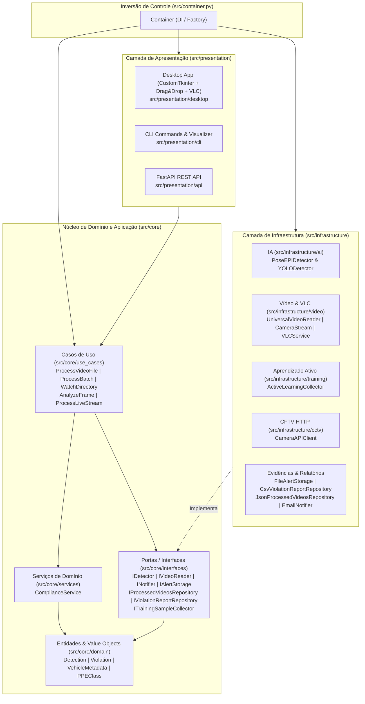

# 🛡️ EPI GUARD — Sistema Corporativo de Detecção e Auditoria de EPI (NR-10 / NR-6)

[](https://www.python.org/)
[](https://fastapi.tiangolo.com/)
[](https://pytorch.org/)
[](https://docs.ultralytics.com/)
[]()
[]()
[]()

> **CRIADO POR CLEYTON BAUMGRATZ**

Sistema corporativo de visão computacional e inteligência artificial para auditoria automatizada de **Equipamentos de Proteção Individual (EPI)** — com foco em **Uniforme RF Classe 2 (NR-10)**, **Capacete de Segurança**, **Luvas de Proteção** e **filtragem inteligente de civis/pedestres** — construído sob os pilares de **Clean Architecture**, **Clean Code**, **SOLID** e **Aprendizado Ativo (Active Learning)**.

---

## ✨ Destaques da Versão 2.0

- **🧠 Detecção Anatômica Híbrida (`PoseEPIDetector` & `YOLODetector`):**
  - Ancoragem anatômica por *keypoints* do esqueleto humano (cabeça/crânio, ombros/torso e pulsos/mãos) para validar **Capacete**, **Uniforme RF Classe 2 (faixa refletiva + pala laranja fluorescente)** e **Luvas**.
  - **Filtro Inteligente de Civis:** Pedestres na via pública são classificados como `civil` (caixa neutra cinza) e **nunca** geram falsos alertas de infração, enquanto motoristas em câmeras internas de cabine (`CH2`, `DMS`, `CABINE`) e trabalhadores uniformizados são auditados rigorosamente.
- **🔄 Ciclo Contínuo de Aprendizado Ativo (Active Learning):**
  - Coleta automática de frames com confiança duvidosa (`30%–60%`), frames que geraram alerta e amostragem exploratória, com deduplicação perceptual (*dHash*).
  - Aba dedicada **`🧠 Revisão p/ Treino`** no aplicativo Desktop com revisão em 1 clique ou atalhos de teclado (`C` = Correto, `F` = Falso Alarme, `V` = Civil, `D` = Descartar) e exportação automática de dataset YOLO (`train`/`val` separados por vídeo).
- **🎬 Integração Nativa com VLC Media Player (`libVLC`) & Leitura `.265` Sem Corrupção:**
  - Decodificação limpa de arquivos brutos de DVR veicular (`.265`, `.h265`, `.hevc`, `.mp4`, `.avi`, `.mkv`) sem artefatos ou quadros verdes.
  - Botão **`🔄 MP4 (VLC)`** para reempacotamento (*remux*) instantâneo de `.265` para `.mp4` sem perda de qualidade e botão **`🎬 VLC`** para reprodução nativa acelerada por hardware.
- **⚡ Instalação e Execução em 1 Clique no Windows:**
  - Scripts automatizados (`.bat`) para provisionamento completo de `.venv`, PyTorch CUDA, VLC e inicialização Desktop/API.

---

## 🏗️ Arquitetura do Sistema (Clean Architecture / Ports & Adapters)

O código é estritamente organizado em camadas concêntricas. O núcleo de negócios (`src/core`) não conhece frameworks externos (OpenCV, PyTorch, CustomTkinter ou FastAPI).



---

## 📁 Estrutura do Repositório

```text
INDICADOR/
├── config/
│   ├── settings.yaml                  # Configurações gerais (IA, Compliance, Batch, Active Learning)
│   └── cameras.yaml                   # Configuração de câmeras CFTV remotas via HTTP/API
├── models/
│   └── best.pt                        # Pesos treinados customizados para detecção de EPI
├── scripts/
│   ├── extract_frames.py              # Extração de frames de vídeos para rotulagem
│   └── train_model.py                 # Fine-tuning, validação e exportação ONNX de modelos YOLO
├── src/
│   ├── config/
│   │   └── settings.py                # Carregamento tipado (Dataclasses + YAML + .env)
│   ├── core/                          # NÚCLEO PURO (Sem dependências de infraestrutura)
│   │   ├── domain/                    # Detection, BoundingBox, Violation, VehicleMetadata, PPEClass
│   │   ├── interfaces/                # Contratos abstratos (Ports)
│   │   ├── services/                  # ComplianceService (confirmação temporal e filtro de civis)
│   │   └── use_cases/                 # Casos de uso da aplicação
│   ├── infrastructure/                # ADAPTADORES TECNOLÓGICOS
│   │   ├── ai/                        # PoseEPIDetector (YOLO-Pose anatômico) e YOLODetector
│   │   ├── cctv/                      # CameraAPIClient (Hikvision, Intelbras, ONVIF, REST)
│   │   ├── notifications/             # EmailNotifier, CompositeNotifier, RateLimiter
│   │   ├── repositories/              # CsvViolationReportRepository, JsonProcessedVideosRepository
│   │   ├── storage/                   # FileAlertStorage (organização por Placa/Data)
│   │   ├── training/                  # ActiveLearningCollector (coleta, revisão e exportação YOLO)
│   │   └── video/                     # UniversalVideoReader, CameraStream, VLCService
│   ├── presentation/                  # INTERFACES COM O USUÁRIO E SISTEMAS EXTERNOS
│   │   ├── api/                       # FastAPI App, Rotas e Schemas Pydantic
│   │   ├── cli/                       # Comandos CLI e renderizador visual OpenCV
│   │   └── desktop/                   # App Desktop CustomTkinter (Views + Widgets + VLC)
│   ├── container.py                   # Container de Injeção de Dependências (IoC)
│   ├── main.py                        # Entrypoint CLI principal
│   ├── desktop.py                     # Entrypoint da interface gráfica Desktop
│   ├── video_batch.py                 # Entrypoint de processamento em lote
│   ├── api.py                         # Entrypoint do servidor FastAPI
│   └── camera_api.py                  # Entrypoint de monitoramento de câmeras via API HTTP
├── tests/
│   ├── unit/                          # Testes unitários isolados por componente
│   └── integration/                   # Testes de integração do pipeline completo e API REST
├── instalar.bat                       # Instalador automático 1-clique (Windows + CUDA + VLC)
├── iniciar.bat                        # Inicializador 1-clique da Interface Desktop
├── iniciar_api.bat                    # Inicializador 1-clique do Servidor FastAPI
├── testar.bat                         # Executor 1-clique da suíte de testes Pytest
├── run_desktop.py                     # Atalho Python para inicialização Desktop
├── pyproject.toml                     # Metadados PEP 621, configuração do Pytest e Ruff
├── requirements.txt                   # Dependências de produção e desenvolvimento
├── Dockerfile                         # Imagem Docker com suporte a NVIDIA CUDA
└── docker-compose.yml                 # Orquestração Docker com reserva de GPU
```

---

## 🚀 Instalação e Execução Rápida (Windows)

### 1. Instalação Automática (1 Clique)
Dê dois cliques em **`instalar.bat`** (ou execute `.\instalar.bat` no terminal). O script irá:
1. Validar a instalação do Python 3.10+.
2. Criar e ativar o ambiente virtual `.venv`.
3. Detectar sua GPU NVIDIA e instalar o **PyTorch com aceleração CUDA**.
4. Instalar todas as bibliotecas do `requirements.txt`.
5. Baixar o modelo base `yolov8n-pose.pt` e instalar o **VLC Media Player** via `winget` caso ausente.

### 2. Abrir o Aplicativo Desktop
Dê dois cliques em **`iniciar.bat`** ou execute:
```powershell
.\iniciar.bat
# ou diretamente:
.\.venv\Scripts\python.exe run_desktop.py
```

### 3. Iniciar o Servidor de API REST (FastAPI)
Dê dois cliques em **`iniciar_api.bat`** ou execute:
```powershell
.\.venv\Scripts\python.exe -m src.api --host 0.0.0.0 --port 8000
```
- **Swagger UI:** `http://localhost:8000/docs`
- **Healthcheck:** `http://localhost:8000/health`

### 4. Processamento em Lote via CLI (`[PLACA] > [DATA] > [VÍDEO]`)
```powershell
# Processar todos os vídeos pendentes na pasta gravacoes/
.\.venv\Scripts\python.exe -m src.video_batch --dir ./gravacoes

# Monitorar continuamente a chegada de novas gravações
.\.venv\Scripts\python.exe -m src.video_batch --dir ./gravacoes --watch
```

---

## 🧠 Ciclo de Aprendizado Ativo (Retreino Contínuo)

1. **Coleta Automática:** Enquanto analisa vídeos ou câmeras, o sistema salva em `datasets/coleta_ativa/pendentes/` os frames onde houve alerta ou confiança incerta (`30%–60%`), junto com os pré-rótulos no formato YOLO (`.txt`).
2. **Curadoria Humana Rápida:** Abra a aba **`🧠 Revisão p/ Treino`** no aplicativo Desktop e revise cada amostra:
   - **`[C]` Correto:** Confirma as caixas previstas pela IA.
   - **`[F]` Falso Alarme:** Inverte automaticamente `no_helmet` → `helmet`, `no_uniform_rf` → `uniform_rf`, `no_gloves` → `gloves`.
   - **`[V]` Civil / Pedestre:** Rotula as pessoas como `civil` para ensinar a IA a ignorar pedestres.
   - **`[D]` Descartar:** Move frames borrados/ambíguos para `rejeitados/`.
3. **Exportação e Retreino:** Clique em **`📦 Exportar Dataset de Treino`** e execute:
   ```powershell
   .\.venv\Scripts\python.exe scripts/train_model.py --data datasets/epi_ativo/data.yaml --epochs 100
   ```

---

## 🎯 Treinamento e Detecção (metodologia do TCC)

Baseado no TCC *"Detecção de EPI's com Ferramenta de Visão Computacional"* (UFPA, 2024):

| Etapa do TCC | Implementação |
|---|---|
| Divisão 83% treino / 12% val / 5% teste | [`prepare_tcc_dataset`](src/infrastructure/training/ppe_trainer.py) |
| Transfer learning YOLOv8 (n/s/m) + augmentation (`degrees`, `scale`, `mixup`, `fliplr`) | [`train_model`](src/infrastructure/training/ppe_trainer.py) |
| Métricas Precision, Recall, F1, mAP (por classe) + comparativo | [`evaluate_model`](src/infrastructure/training/ppe_trainer.py) / `runs/tcc/comparativo.md` |

```powershell
# Treina (unifica construction-ppe, synapsis_ppe do TCC e ppe-wm4s0 do Roboflow), avalia e instala o melhor modelo em models/epi_best.pt
.\.venv\Scripts\python.exe scripts/train_tcc.py --models yolov8n.pt yolov8s.pt --epochs 50
# Compara estabilidade (flicker) Pose vs Híbrido em um vídeo
.\.venv\Scripts\python.exe scripts/benchmark_stability.py gravacoes/ABC1D23/2026-10-04/camera_operacao_01.mp4
```

**Detector híbrido** (`detection.backend: hybrid`): YOLO-Pose localiza e estabiliza a caixa da pessoa → modelo YOLOv8 de EPIs roda no **recorte enquadrado** (`crop_padding: 0.18`) de cada trabalhador → evidências são fundidas e estabilizadas por **EMA + histerese** ([`PPEStateSmoother`](src/core/services/ppe_state_smoother.py)). EPI confirmado pelo modelo nunca gera infração; ausência só é emitida quando estável (e o `ComplianceService` não fabrica violações durante estados `UNKNOWN`).

---

## 🧪 Testes e Qualidade de Código

Para rodar toda a suíte de testes automatizados (unitários + integração):
```powershell
.\testar.bat
# ou:
.\.venv\Scripts\python.exe -m pytest
```

---

## 👨‍💻 Autor

**CRIADO POR CLEYTON BAUMGRATZ**

